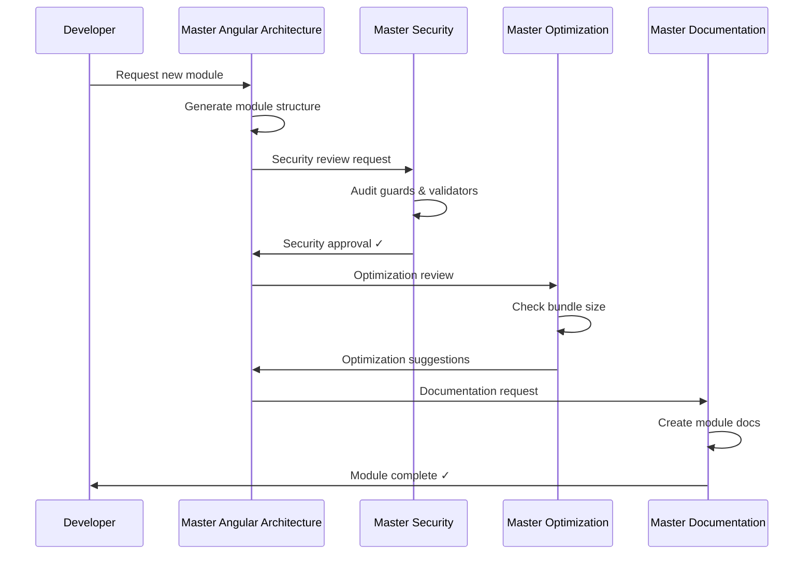
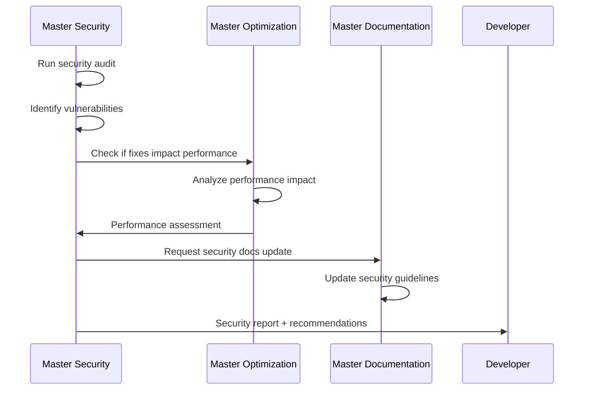
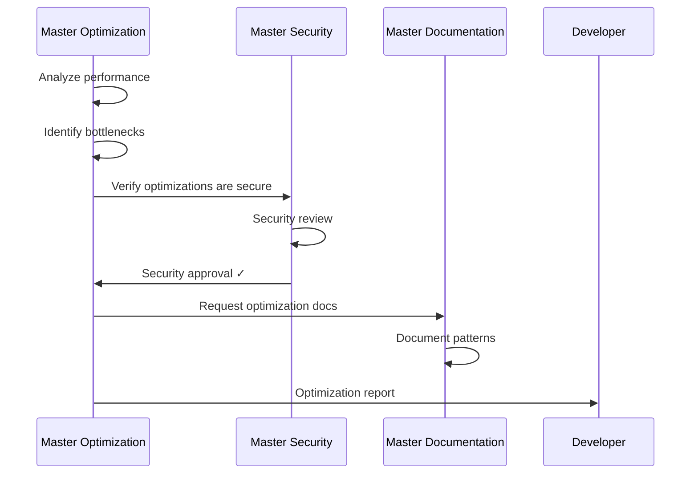
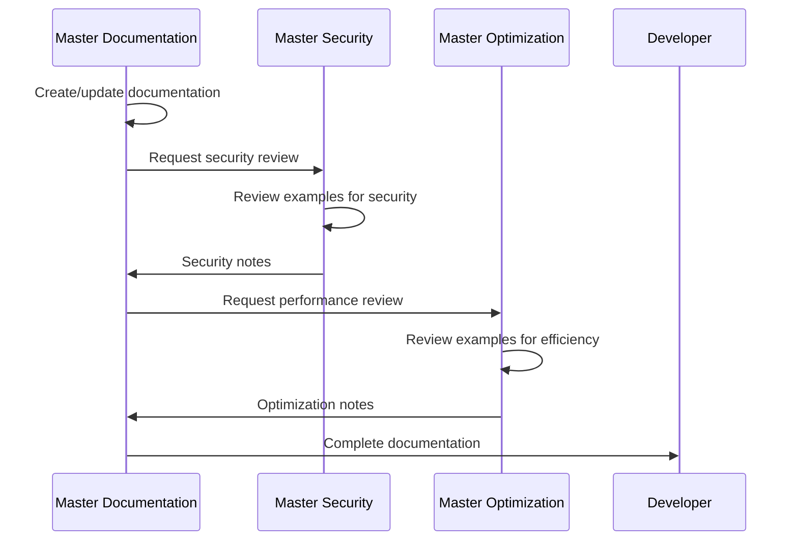
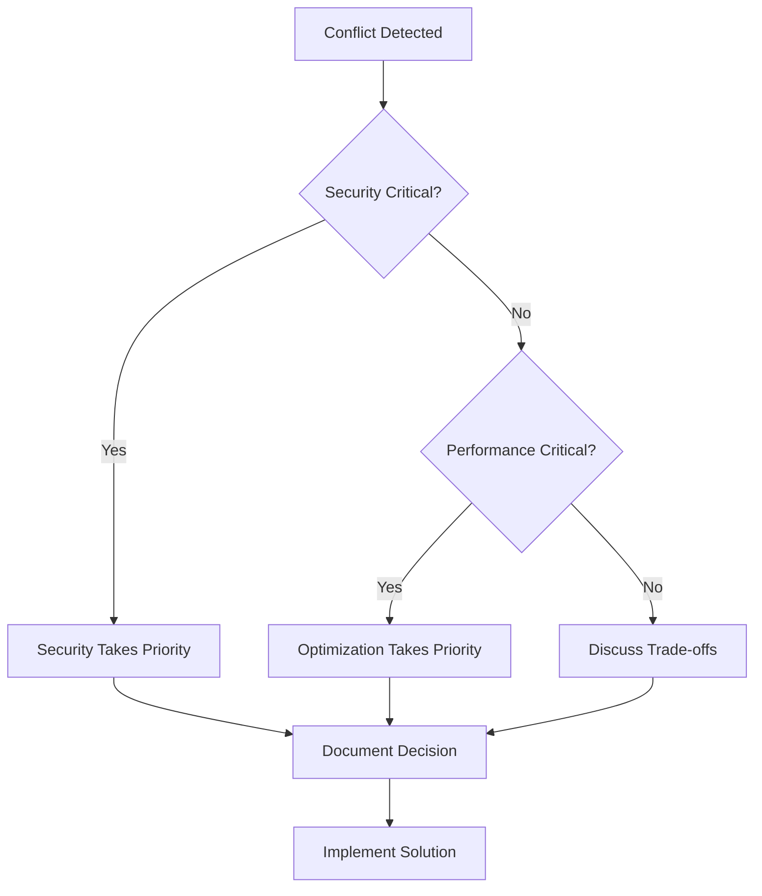

# Agents Integration Guide

## Overview

This guide describes how the four Master Agents work together to maintain and improve the Lexand project. Each agent has specialized responsibilities, but they collaborate to ensure comprehensive coverage of architecture, documentation, security, and performance.

## Agent Ecosystem

```
┌─────────────────────────────────────────────────────────────────┐
│                        Lexand Project                            │
├─────────────────────────────────────────────────────────────────┤
│                                                                  │
│  ┌──────────────────┐  ┌──────────────┐  ┌──────────────────┐  │
│  │     Master       │  │    Master    │  │     Master       │  │
│  │  Documentation   │◄─┤   Security   │◄─┤  Optimization    │  │
│  │                  │─►│              │─►│                  │  │
│  └──────────────────┘  └──────────────┘  └──────────────────┘  │
│           ▲                    ▲                    ▲           │
│           │                    │                    │           │
│           └────────────────────┴────────────────────┘           │
│                                │                                │
│                                ▼                                │
│                    ┌───────────────────────────┐               │
│                    │  Master Angular           │               │
│                    │  Architecture Agent       │               │
│                    └───────────────────────────┘               │
│                                                                  │
└─────────────────────────────────────────────────────────────────┘
```

## Agent Responsibilities

### Master Angular Architecture Agent

**Primary Role**: Angular module development with TDD, SOLID, DRY, and DDD principles

**Key Responsibilities**:

- Design and implement feature modules using Angular 21
- Follow Test-Driven Development (write tests before implementation)
- Apply SOLID principles in all code
- Ensure DRY principles (no code duplication)
- Implement Domain-Driven Design
- Write self-documenting code (NO comments)
- Use modern Angular syntax (@if, @for, signals)

**Output**:

- Complete CRUD modules with pages, services, models
- Unit tests with Vitest
- Type-safe interfaces and models
- Reactive forms with validation
- Clean, maintainable code

**Triggers**:

- New module/feature requests
- Module refactoring needs
- Code quality improvements
- TDD implementation requests

### Master Documentation Agent

**Primary Role**: Technical documentation and knowledge management

**Key Responsibilities**:

- Create and maintain module documentation
- Document API endpoints with examples
- Write architecture guides and tutorials
- Ensure documentation consistency
- Provide code examples and best practices

**Output**:

- `docs/modules/*.md` - Module documentation
- `docs/*.md` - Architecture and guides
- Code examples and tutorials

**Triggers**:

- New module created
- API changes
- Architecture updates
- Documentation requests

### Master Security Agent

**Primary Role**: Security auditing and compliance

**Key Responsibilities**:

- Audit authentication and authorization
- Review API security implementations
- Identify vulnerabilities (OWASP Top 10)
- Verify input validation
- Ensure GDPR compliance

**Output**:

- Security audit reports
- Vulnerability assessments
- Security recommendations
- Secure code examples

**Triggers**:

- New feature implementation
- Authentication changes
- API endpoint additions
- Security reviews
- Pre-deployment checks

### Master Optimization Agent

**Primary Role**: Performance optimization and code quality

**Key Responsibilities**:

- Analyze bundle size and composition
- Optimize runtime performance
- Improve build times
- Refactor code for efficiency
- Monitor Core Web Vitals

**Output**:

- Performance reports
- Bundle analysis
- Optimization recommendations
- Refactoring suggestions

**Triggers**:

- Bundle size increases
- Performance degradation
- New feature additions
- Build time increases
- Pre-deployment checks

## Collaboration Workflows

### Workflow 1: New Module Development



**Steps**:

1. **Master Angular Architecture Agent** generates module
   - Creates pages, services, models
   - Implements validators and guards
   - Sets up routing

2. **Master Security** reviews implementation
   - Verifies guards on all routes
   - Checks validation rules
   - Audits API security
   - Approves or requests changes

3. **Master Optimization** analyzes performance
   - Checks bundle impact
   - Reviews lazy loading
   - Suggests optimizations
   - Validates performance budgets

4. **Master Documentation** creates docs
   - Documents all interfaces
   - Records API endpoints
   - Provides code examples
   - Updates architecture docs

### Workflow 2: Security Audit



**Steps**:

1. **Master Security** performs audit
   - OWASP Top 10 check
   - Authentication review
   - Input validation audit
   - Dependency scan

2. **Master Optimization** consulted
   - Verify security fixes don't hurt performance
   - Balance security and efficiency
   - Suggest optimal implementations

3. **Master Documentation** updates docs
   - Document security patterns
   - Update best practices
   - Add secure code examples
   - Create security guidelines

4. **Developer** receives comprehensive report
   - Vulnerabilities identified
   - Performance-optimized fixes
   - Documentation references

### Workflow 3: Performance Optimization



**Steps**:

1. **Master Optimization** analyzes performance
   - Bundle size analysis
   - Runtime profiling
   - Memory leak detection
   - Build time optimization

2. **Master Security** validates optimizations
   - Ensure caching is secure
   - Verify lazy loading doesn't expose data
   - Check that optimizations maintain security

3. **Master Documentation** documents patterns
   - Add optimization examples
   - Update performance guidelines
   - Document benchmarks
   - Create optimization guide

4. **Developer** implements optimizations
   - Performance-tested solutions
   - Security-approved patterns
   - Well-documented approaches

### Workflow 4: Documentation Update



**Steps**:

1. **Master Documentation** creates content
   - Module documentation
   - API references
   - Code examples
   - Architecture guides

2. **Master Security** reviews examples
   - Ensure secure patterns
   - Verify no vulnerabilities
   - Add security notes
   - Suggest improvements

3. **Master Optimization** reviews examples
   - Check for performance issues
   - Suggest optimizations
   - Add performance notes
   - Validate best practices

4. **Developer** receives validated docs
   - Secure code examples
   - Performance-optimized patterns
   - Comprehensive documentation

## Integration Points

### 1. Code Review Integration

**When**: After code generation or significant changes

**Process**:

```typescript
// Angular Architecture generates code
const newModule = architectureAgent.generateModule('products');

// Security audit
const securityReport = securityAgent.audit(newModule);
if (!securityReport.passed) {
  return securityReport.issues;
}

// Performance check
const perfReport = optimizationAgent.analyze(newModule);
if (perfReport.bundleSize > budget) {
  return perfReport.optimizations;
}

// Document module
const docs = documentationAgent.document(newModule);

return {
  module: newModule,
  security: securityReport,
  performance: perfReport,
  documentation: docs,
};
```

### 2. Continuous Monitoring

**Daily Tasks**:

- **Master Security**: Scan for new vulnerabilities
- **Master Optimization**: Monitor bundle size
- **Master Documentation**: Check for outdated docs

**Weekly Tasks**:

- **Master Security**: Comprehensive security audit
- **Master Optimization**: Performance benchmarking
- **Master Documentation**: Documentation review

**Monthly Tasks**:

- **All Agents**: Comprehensive project review
- **All Agents**: Update guidelines and standards
- **All Agents**: Generate improvement reports

### 3. Pre-Deployment Checklist

Before any deployment, all agents collaborate:

```markdown
## Pre-Deployment Checklist

### Master Security

- [ ] No critical vulnerabilities
- [ ] All routes protected
- [ ] Input validation complete
- [ ] No hardcoded secrets
- [ ] Dependencies updated

### Master Optimization

- [ ] Bundle size within budget
- [ ] Performance tests passing
- [ ] No memory leaks
- [ ] Build time acceptable
- [ ] Core Web Vitals good

### Master Documentation

- [ ] All features documented
- [ ] API docs updated
- [ ] Examples tested
- [ ] Changelog updated
- [ ] README current
```

## Communication Protocol

### Agent-to-Agent Communication

**Format**:

```json
{
  "from": "master-security",
  "to": "master-optimization",
  "type": "review-request",
  "context": {
    "module": "customers",
    "concern": "caching-strategy",
    "details": "Implementing HTTP cache with 5min TTL"
  },
  "question": "Does this caching strategy have performance implications?"
}
```

**Response**:

```json
{
  "from": "master-optimization",
  "to": "master-security",
  "type": "review-response",
  "context": {
    "module": "customers",
    "concern": "caching-strategy"
  },
  "assessment": "approved",
  "notes": "5min TTL is optimal. Reduces API calls by ~80%.",
  "recommendations": [
    "Implement cache invalidation on mutations",
    "Add cache size limits",
    "Monitor cache hit rate"
  ]
}
```

### Cross-Agent Reviews

Each agent can request review from others:

**Security Review Request**:

```typescript
// When Master Optimization suggests a change
const securityReview = await masterSecurity.review({
  type: 'optimization',
  changes: ['implement-http-cache', 'lazy-load-components'],
  module: 'customers',
});

if (!securityReview.approved) {
  // Address security concerns first
  return securityReview.concerns;
}
```

**Performance Review Request**:

```typescript
// When Master Security suggests a change
const perfReview = await masterOptimization.review({
  type: 'security',
  changes: ['add-encryption', 'implement-rate-limiting'],
  module: 'customers',
});

if (perfReview.impact > threshold) {
  // Consider performance trade-offs
  return perfReview.alternatives;
}
```

**Documentation Review Request**:

```typescript
// When any agent needs documentation
const docReview = await masterDocumentation.review({
  type: 'code-example',
  content: exampleCode,
  module: 'customers',
});

if (!docReview.complete) {
  // Documentation needs improvement
  return docReview.suggestions;
}
```

## Best Practices for Agent Collaboration

### 1. Always Communicate

- **Before making changes**: Notify relevant agents
- **After implementing**: Request validation
- **When uncertain**: Ask for input

### 2. Respect Specializations

- **Security questions** → Master Security
- **Performance questions** → Master Optimization
- **Documentation questions** → Master Documentation

### 3. Provide Context

When requesting review:

- What changed
- Why it changed
- What impact expected
- What validation needed

### 4. Validate Cross-Impacts

Security changes may affect:

- Performance (encryption overhead)
- Documentation (new patterns)

Performance changes may affect:

- Security (caching sensitive data)
- Documentation (new strategies)

Documentation changes may need:

- Security review (example code)
- Performance review (recommended patterns)

### 5. Maintain Consistency

All agents should:

- Follow Lexand architecture
- Use consistent terminology
- Reference same standards
- Update shared guidelines

## Conflict Resolution

When agents disagree:

### Priority Order

1. **Security** > Performance > Documentation
   - Security vulnerabilities must be fixed
   - Even if performance impact exists

2. **Critical Performance** > Non-critical Security
   - If app is unusable due to performance
   - Can temporarily prioritize optimization
   - Must plan security fix

3. **Documentation** supports both
   - Documents trade-offs
   - Provides alternatives
   - Explains decisions

### Resolution Process



### Example: Caching Conflict

**Scenario**: Master Optimization wants to cache user data for 1 hour. Master Security concerned about stale data.

**Resolution**:

1. **Identify concern**: Stale vs. fresh data
2. **Analyze impact**:
   - Security: Medium risk (user sees old data)
   - Performance: High gain (80% reduction in API calls)
3. **Find compromise**:
   - Cache for 5 minutes (not 1 hour)
   - Invalidate on mutations
   - Add manual refresh option
4. **Document decision**:
   - Why 5 minutes chosen
   - How invalidation works
   - When to refresh manually

## Tools and Infrastructure

### Shared Resources

All agents have access to:

- Source code repository
- Documentation directory
- Build and test scripts
- Performance metrics
- Security scan results

### Agent-Specific Tools

**Master Documentation**:

- Read/Write to `docs/`
- Markdown generation
- Code example validation

**Master Security**:

- Security scanning tools
- Dependency auditing
- OWASP check tools
- Compliance validators

**Master Optimization**:

- Bundle analyzers
- Performance profilers
- Build optimizers
- Benchmarking tools

### Shared Standards

All agents follow:

- Lexand Architecture Rules
- TypeScript strict mode
- Angular 21 best practices
- PrimeNG 21 guidelines
- SOLID, DRY, DDD principles

## Reporting Structure

### Individual Reports

Each agent generates specialized reports:

**Security Report**:

```
docs/reports/security/YYYY-MM-DD-security-audit.md
```

**Performance Report**:

```
docs/reports/performance/YYYY-MM-DD-performance-analysis.md
```

**Documentation Report**:

```
docs/reports/documentation/YYYY-MM-DD-doc-coverage.md
```

### Unified Report

Combined report for comprehensive view:

```markdown
# Lexand Project Health Report

**Date**: 2025-01-16

## Security Status

- **Overall Score**: 95/100 ✅
- **Critical Issues**: 0
- **High Priority**: 1
- **Compliance**: GDPR ✅, OWASP ✅

## Performance Status

- **Bundle Size**: 180 KB ✅ (Target: 200 KB)
- **Load Time**: 1.2s ✅ (Target: 2.5s)
- **Performance Score**: 98/100 ✅

## Documentation Status

- **Coverage**: 90% ✅ (Target: 85%)
- **Outdated**: 2 files
- **Missing**: 1 module

## Recommendations

1. [Security] Update password policy (High)
2. [Performance] Implement virtual scrolling (Medium)
3. [Documentation] Document Products module (Medium)

## Overall Status: ✅ HEALTHY
```

## Success Metrics

### Individual Metrics

**Master Security**:

- Vulnerabilities found and fixed
- Zero critical issues in production
- 100% route protection
- GDPR compliance maintained

**Master Optimization**:

- Bundle size under budget
- Core Web Vitals in green
- Build time improvements
- Zero memory leaks

**Master Documentation**:

- 100% feature coverage
- All APIs documented
- Zero broken links
- Consistent terminology

### Collaboration Metrics

- **Response Time**: < 1 hour for agent-to-agent reviews
- **Conflict Resolution**: < 24 hours
- **Cross-Validation**: 100% of changes reviewed by relevant agents
- **Documentation Accuracy**: 100% of examples validated

## Future Enhancements

### Planned Improvements

1. **Automated Triggers**
   - Auto-run security audit on commits
   - Auto-analyze performance on builds
   - Auto-update docs on API changes

2. **AI Learning**
   - Learn from past issues
   - Improve recommendations
   - Predict potential problems

3. **Integration Deepening**
   - Real-time collaboration
   - Automated conflict resolution
   - Proactive suggestions

4. **Reporting Enhancement**
   - Interactive dashboards
   - Trend analysis
   - Predictive analytics

## Getting Started

### For Developers

1. **Request Module Creation**:

   ```
   Ask Angular Architecture Agent to create module
   ```

2. **Wait for Multi-Agent Review**:
   - Security audit completes
   - Performance analysis done
   - Documentation generated

3. **Review Reports**:
   - Check security findings
   - Review performance metrics
   - Read documentation

4. **Implement Recommendations**:
   - Fix security issues
   - Apply optimizations
   - Update documentation

### For Project Managers

1. **Review Health Reports**:
   - Weekly unified reports
   - Monthly trend analysis
   - Quarterly deep dives

2. **Prioritize Recommendations**:
   - Security first
   - Performance second
   - Documentation third

3. **Track Metrics**:
   - Security score trends
   - Performance improvements
   - Documentation coverage

## Contact and Support

### Agent Activation

Each agent can be invoked using the Task tool:

```typescript
// Invoke Master Documentation
task({
  subagent_type: 'documentation',
  description: 'Document customers module',
  prompt: 'Create comprehensive documentation for the customers module',
});

// Invoke Master Security
task({
  subagent_type: 'security',
  description: 'Security audit',
  prompt: 'Perform security audit on customers module focusing on authentication',
});

// Invoke Master Optimization
task({
  subagent_type: 'optimization',
  description: 'Performance analysis',
  prompt: 'Analyze bundle size and suggest optimizations for customers module',
});
```

### Questions or Issues

- **Documentation**: Contact Master Documentation Agent
- **Security**: Contact Master Security Agent
- **Performance**: Contact Master Optimization Agent
- **General**: Any agent can route to appropriate specialist

## Version History

- **v1.0.0** (2025-01-16) - Initial Agents Integration Guide
  - Defined agent responsibilities
  - Established collaboration workflows
  - Created communication protocols
  - Set success metrics
