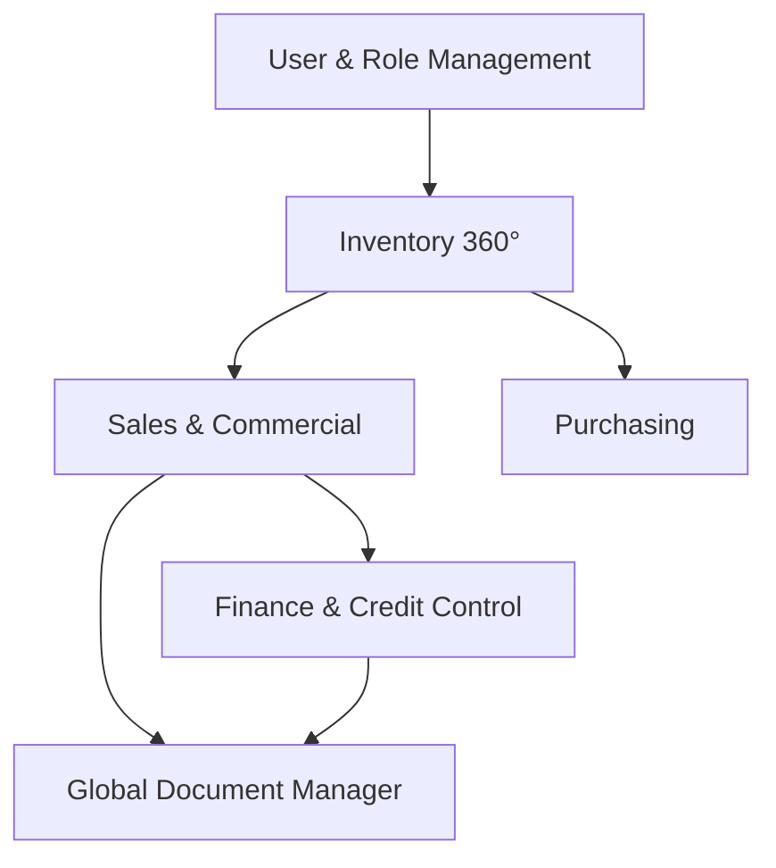

# Cashly – B2B Web Administrative System

## Project Vision

The Cashly project is a **B2B Web Administrative System** that digitizes and centralizes the company's operational cycle, from inventory management to collections.

The system is built from scratch, drawing inspiration from key modules of the **Valery ERP**, adapted to a modern, scalable, and growth-oriented architecture.

---

## Strategic Goals

| Goal                            | Description                                                          |
| ------------------------------- | -------------------------------------------------------------------- |
| **Real-Time Inventory Control** | Full traceability and precise stock management across all warehouses |
| **Commercial Automation**       | Streamlined flow from quotation to invoice with minimal friction     |
| **Credit & Payment Management** | Structured financial control with partial payments and credit limits |
| **Document Automation**         | PDF generation for every operational document                        |
| **Scalability**                 | Modular architecture prepared for future growth                      |

---

## Functional Scope

### Module 1 – User & Role Management

**Features:**

- User creation and administration
- Role assignment: Super Admin, Administration, and Operators
- Module-level access control
- Secure login panel

**Impact:** Ensures operational security and hierarchical control across the system.

---

### Module 2 – Inventory Management (Inventory 360°)

**Features:**

- Warehouse/branch creation and management
- Product registration and administration
- Multi-level pricing: maximum, promotional, wholesale, minimum
- Price variation by branch/warehouse
- Composite products (kits) with automatic per-unit discount logic
- Inventory operations:
  - Stock entries (loads)
  - Stock exits (discharges)
  - Inter-warehouse transfers
  - Adjustments
  - Internal use write-offs
- Real-time stock availability control
- PDF document generation per operation

**Impact:** Enables traceability, precise stock control, and reduction of operational errors.

---

### Module 3 – Commercial Management (Sales)

**Features:**

- Quotations (budgets) without inventory lock
- Quotation-to-order conversion
- Orders with automatic inventory reservation
- Operational order approval workflow
- Administrative invoicing
- Smart invoice copying with automatic price updates
- PDF document generation
- Customer document history
- Document manager with advanced filters

**Impact:** Automates the complete commercial flow and reduces operational friction.

---

### Module 4 – Finance & Credit Control

**Features:**

- Accounts receivable per customer
- Partial payment management
- Advance payments (credit balance / saldo a favor)
- Configurable credit limits per customer
- Credit notes
- Debit notes
- Automatic and manual returns with inventory reintegration
- Basic financial reports
- Payment method registration (bank transfer, cash, foreign currency, etc.)

**Impact:** Provides structured financial control and flexible management for wholesale clients.

---

### Module 5 – Purchasing

**Features:**

- Supplier management
- Purchase orders
- Purchase order reception
- Automatic stock entry registration on reception
- Purchase history per supplier

**Impact:** Closes the complete operational cycle from procurement to sale.

---

### Module 6 – Global Document Manager

**Features:**

- Invoice listing
- Order listing
- Quotation listing
- Return listing
- Advanced filters by date, customer, salesperson, and status

**Impact:** Centralizes information and facilitates operational auditing.

---

## Development Methodology

The project is developed in **critical phases**, enabling progressive testing and validation:

```
Phase 1 → Operational Core        (Inventory + Sales)
Phase 2 → Finance & Credit        (Payments, Credit, Returns)
Phase 3 → Reporting & Optimization
```

### Benefits of Phased Delivery

- Partial functional deliveries after each phase
- Validation in real operational environment
- Reduced technical risk
- Progressive implementation with minimal disruption

**Estimated Total Duration:** 4 to 6 months

---

## Project Scope Summary

This system is not a simple administrative interface — it represents the **complete digitization of the company's operational model**.



### Core Technical Capabilities

| Capability                         | Description                                         |
| ---------------------------------- | --------------------------------------------------- |
| **Transactional Inventory Engine** | Real-time stock operations with full audit trail    |
| **Credit & Partial Payment Logic** | Flexible financial management for wholesale clients |
| **Automated Document Management**  | PDF generation and document lifecycle tracking      |
| **Composite Product Logic**        | Dynamic kit pricing with per-unit discount rules    |
| **Full Commercial Flow**           | Quotation → Order → Invoice pipeline                |

---

## Technology Stack

| Layer                | Technology                                        |
| -------------------- | ------------------------------------------------- |
| **Backend**          | Java 24 + Spring Boot 3.5.5                       |
| **Architecture**     | Hexagonal Architecture + DDD + Clean Architecture |
| **Database**         | MySQL                                             |
| **Authentication**   | JWT (Role-based access control)                   |
| **Documentation**    | OpenAPI / Swagger                                 |
| **Containerization** | Docker + Docker Compose                           |

---

## Module Documentation Index

| Module                 | Documentation                              |
| ---------------------- | ------------------------------------------ |
| Authentication & Users | [AUTH.md](modules/AUTH.md)                 |
| Products & Inventory   | [PRODUCTS.md](modules/PRODUCTS.md)         |
| Warehouse & Stock      | [WAREHOUSE.md](modules/WAREHOUSE.md)       |
| Customers              | [CUSTOMERS.md](modules/CUSTOMERS.md)       |
| Differential Pricing   | [DIFFERENTIAL.md](modules/DIFFERENTIAL.md) |
| API Endpoints          | [API.md](API.md)                           |
| Architecture           | [ARCHITECTURE.md](ARCHITECTURE.md)         |
| Business Rules         | [BUSINESS_RULES.md](BUSINESS_RULES.md)     |
| Workflows              | [WORKFLOWS.md](WORKFLOWS.md)               |
| Roadmap                | [ROADMAP.md](ROADMAP.md)                   |
| Setup Guide            | [SETUP.md](SETUP.md)                       |
| Testing Strategy       | [TESTING.md](TESTING.md)                   |
| Deployment             | [AWS_DEPLOYMENT.md](AWS_DEPLOYMENT.md)     |
